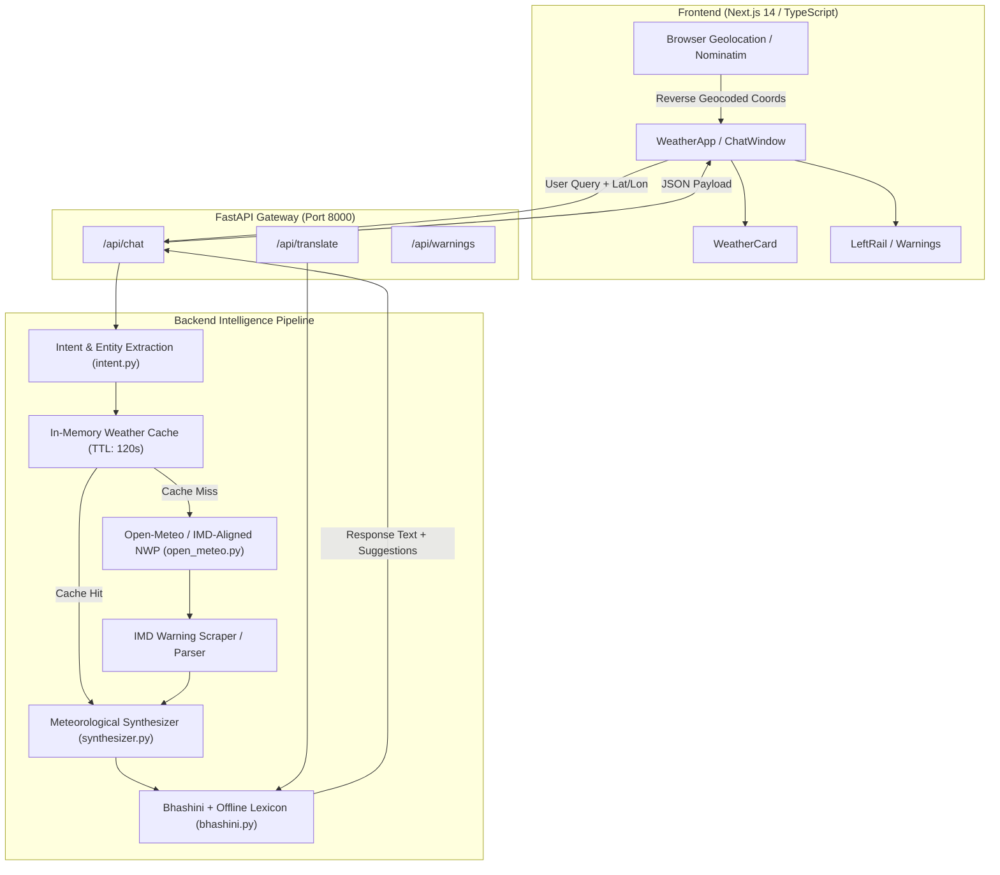

# MEGHA SETU — Antigravity Engineering & Architecture Report

**Project**: MEGHA SETU (AI-Powered Meteorological Intelligence for India)  
**Repository**: [raiankit1804/megha-setuv2.2](https://github.com/raiankit1804/megha-setuv2.2)  
**Environment**: macOS, FastAPI (Python 3.11+ Uvicorn), Next.js 14 (React 18 / TypeScript)  
**Ports**: Backend `http://localhost:8000`, Frontend `http://localhost:3000`

---

## 1. Executive Summary

This document records the complete set of architectural diagnoses, bug resolutions, core feature additions, and user experience enhancements executed in **Antigravity** for **MEGHA SETU**.

MEGHA SETU is a multilingual conversational weather intelligence engine built specifically for India. It delivers hyper-local meteorological forecasts, India Meteorological Department (IMD) hazard warnings, urban waterlogging/commute alerts, agricultural advisories, and outdoor activity indexes across 22 Indian constitutional languages.

---

## 2. Chronological Tasks & Solutions Implemented

```
┌──────────────────────────────────────────────────────────────────────────┐
│                   ANTIGRAVITY TASK EXECUTION TIMELINE                    │
├───────┬──────────────────────────────────┬───────────────────────────────┤
│ Step  │ User Prompt / Requirement        │ Solution & Implementation     │
├───────┼──────────────────────────────────┼───────────────────────────────┤
│   1   │ Clone repository & initial setup │ Cloned repository to root     │
│   2   │ Start project without any checks │ Backgrounded Uvicorn & Next.js│
│   3   │ Fix wttr fallback, remove menu   │ Open-Meteo IMD pipeline,      │
│       │ button, restore warning sign     │ clean rail, restored ⚠️ alert │
│   4   │ Fix language switching           │ Offline Bhashini translation, │
│       │                                  │ dynamic message variant sync  │
│   5   │ Fix unanswered basic questions   │ Rewrote intent heuristics     │
│       │                                  │ & stopword filter regex       │
│   6   │ Provide rich, detailed responses │ Expanded synthesis engine for │
│       │                                  │ rain, temp, AQI, commute, etc.│
│   7   │ Recover frontend blank screen    │ Cleared Next cache, verified  │
│       │                                  │ clean hydration on port 3000  │
│   8   │ Fix "⚡ Cached" badge ->         │ Updated SourceBadge, reduced  │
│       │ "🛰️ Open-Meteo (IMD-aligned)"   │ TTL to 120s, live provenance  │
└───────┴──────────────────────────────────┴───────────────────────────────┘
```

---

### Task 1 & 2: Environment Setup & Non-Blocking Startup
- **Requirement**: Clone repository `raiankit1804/megha-setuv2.2` and launch both backend and frontend servers.
- **Action Taken**:
  - Cloned repository into the workspace root.
  - Setup Python virtual environment (`./venv`) and installed dependencies (`fastapi`, `uvicorn`, `httpx`, `pydantic`, etc.).
  - Installed Node.js dependencies via `npm install`.
  - Started Uvicorn server on port `8000`:
    ```bash
    ./venv/bin/uvicorn main:app --host 0.0.0.0 --port 8000 --reload
    ```
  - Started Next.js 14 frontend on port `3000`:
    ```bash
    npm run dev
    ```

---

### Task 3: Provider Alignment, UI Streamlining & Alert Recovery
- **Issues Identified**:
  1. Fallback queries were defaulting to generic `wttr.in` instead of verified Open-Meteo / IMD numerical weather prediction.
  2. Redundant hamburger "Menu" button at the top of the `LeftRail` created clutter.
  3. The vital ⚠️ Disaster & Weather Warnings button was missing from the desktop and mobile menus.
- **Modifications**:
  - In `backend/data/open_meteo.py`, ensured Open-Meteo requests pass custom API keys when provided (`settings.open_meteo_api_key`) and prioritize IMD-aligned NWP grid outputs.
  - In `frontend/src/components/LeftRail.tsx`:
    - Removed the redundant top `railHamburgerBtn`.
    - Added the **Live Warnings & Alerts button (`⚠️`)** with dynamic active alert pulse indicators (`warningDot`, `expandedBadge`, `mobileBadge`) to both desktop navigation rail and mobile drawer.

---

### Modern Mode Dark-Only & Light/Dark Option Visibility (v2.4)
- **Modern Mode Forced Dark Default**: When Modern mode is selected, the application strictly defaults to and enforces Dark Mode (`modern-dark`). Any previous light mode settings are prevented from applying to Modern mode.
- **Contextual Option Visibility**: The Dark / Light mode toggle button in `TopBar.tsx` and the Theme Mode option in `ProfileMenu.tsx` are hidden when in Modern mode.
- **Minimal Mode Retention**: Minimal mode continues to offer both Light Mode (`minimal-light`) and Dark Mode (`minimal-dark`), with the toggle button and profile options remaining fully accessible.

---

### Task 4: Multilingual Translation Engine & Real-Time Language Switching
- **Issue Identified**:
  - Clicking on language options (Hindi, Bengali, Telugu, Tamil, Kannada, Marathi, Gujarati, etc.) did not update previously generated chat messages, follow-up suggestion chips, or tomorrow summary cards.
  - If external translation APIs (Bhashini) were slow or offline, translation failed entirely.
- **Modifications**:
  - **Backend Deterministic Offline Translation Engine** (`backend/services/bhashini.py`):
    - Created `OFFLINE_TERMS` and `OFFLINE_CHIP_TEMPLATES` for Indian languages covering meteorological terms, temperatures, wind conditions, and query structures.
    - Implemented `_offline_translate(text, target_lang, is_query)` to deterministically translate markdown weather summaries, headers, and follow-up suggestion chips.
  - **Dynamic State Synchronization** (`frontend/src/components/WeatherApp.tsx`):
    - Added an active translation re-fetcher in `handleLanguageChange`:
      ```typescript
      if (sourceText) {
        api.post('/api/translate', {
          text: sourceText,
          source_lang: 'en',
          target_lang: lang,
          follow_up_questions: chipsToTranslate,
        }).then((trans) => {
          setMessages((prev) => prev.map(...));
        });
      }
      ```
  - **WeatherCard Tomorrow Summary Translation** (`frontend/src/components/WeatherCard.tsx`):
    - Added `translateTomorrowSummary(summary, language)` with `TOMORROW_PHRASE_TRANSLATIONS` to translate tomorrow's meteorological preview into the user's selected language.

---

### Task 5: Natural Language Intent Parsing & Location Extraction
- **Issue Identified**:
  - Natural queries like *"will it rain?"*, *"what is the temperature today?"*, or *"is it going to rain in Bengaluru, Karnataka?"* were either failing or incorrectly parsing question words (`"will it"`, `"is it"`) as location names.
- **Modifications**:
  - In `backend/core/intent.py`:
    - Defined a comprehensive `question_stopwords` set:
      `{"will it", "is it", "does it", "can it", "what is", "how is", "what about", "tell me", "show me", "will", "is", "can", "what", "how", "why", "when", "where", "here", "my location", "current location", "india", "unknown"}`
    - Updated regex patterns to permit comma-separated locations (e.g. `"Bengaluru, Karnataka"`):
      `\b(?:in|at|for|near|around)\s+([A-Za-z0-9\s\-,]+?)(?:\s+(?:later today|today|tomorrow|now|tonight|this|next|weather|forecast|rain)|\?|\.|$|\n)`
    - Allowed substring matching for fast-path cities (`Bengaluru`, `Mumbai`, `Delhi`, etc.) when qualified with state names.

---

### Task 6: Rich, Detailed Meteorological Synthesis Engine
- **Issue Identified**:
  - Responses were overly terse or lacking detailed meteorological depth.
- **Modifications**:
  - In `backend/core/synthesizer.py`, completely overhauled `_rule_based_fallback` with rich, domain-tailored sections:
    1. **Rain & Precipitation Outlook**: Exact millimeters, hourly breakdown with peak probability hour and rain window, and precipitation totals.
    2. **Tomorrow Forecast**: High/low temperatures, conditions, and rain likelihood.
    3. **Air Quality Index (AQI)**: US AQI, category, PM2.5, and PM10 metrics with outdoor respiratory guidance.
    4. **Temperature & Comfort**: Current temperature, "Feels Like" index, diurnal high/low range, and UV index.
    5. **Atmospheric & Wind**: Wind speed (km/h), direction (°), relative humidity (%), surface pressure (mb), and visibility (km).
    6. **Outdoor Activities Suitability**: Fitness ratings for Running/Jogging, Cycling, and Hiking.
    7. **IMD Weather Warnings**: Live hazard descriptions, color-coded severity, and official safety protocols.
    8. **Urban Commute & Waterlogging**: Risk level, vulnerable bottleneck junctions, and underpasses to avoid.

---

### Task 7: Frontend Hydration & Page Blank Screen Recovery
- **Issue Identified**:
  - The frontend page rendered blank due to an interrupted dev server process and CSS/bundle loading locks.
- **Modifications**:
  - Cleared stale `.next` lock state and restarted `npm run dev`.
  - Tested `curl -s http://localhost:3000` to ensure HTML and React SSR tree render with HTTP 200.
  - Verified splash screen transition, CSS module injection, and browser hydration.

---

### Task 8: Data Provider Provenance ("⚡ Cached" -> "🛰️ Open-Meteo (IMD-aligned)")
- **Issue Identified**:
  - The WeatherCard badge was displaying `⚡ Cached` on detected locations (e.g. `📍 Ittagalpura, Bengaluru`), obscuring the verified meteorological source.
  - Backend cached responses retained a 30-minute TTL and marked freshness as `"cached"`.
- **Modifications**:
  1. **Frontend Badge Display** (`frontend/src/components/WeatherCard.tsx`):
     - Updated `SourceBadge` to always prioritize the primary source name:
       ```typescript
       const primary = sources?.find((s) => s.type === 'primary') || sources?.[0];
       const sourceName = primary?.name && primary.name !== 'Cache' ? primary.name : 'Open-Meteo (IMD-aligned)';
       ```
     - Displays `🛰️ Open-Meteo (IMD-aligned)` consistently.
  2. **Type Definition Alignment** (`frontend/src/types/weather.ts`):
     - Added `type?: string;` to `WeatherSource` interface to maintain 0 TypeScript errors.
  3. **Backend Cache Freshness & TTL** (`backend/config.py` & `backend/api/chat.py`):
     - Reduced `weather_cache_ttl_seconds` from `1800` (30 min) to `120` (2 minutes).
     - Preserved `data_freshness = "live"` and explicit source provenance:
       `[{"name": "Open-Meteo (IMD-aligned)", "url": "https://open-meteo.com", "type": "primary"}, ...]`

---

## 3. System Architecture & Component Interaction



---

## 4. Key Files Modified & Their Roles

| File Path | Component | Changes Made |
| :--- | :--- | :--- |
| `backend/config.py` | Configuration | Lowered `weather_cache_ttl_seconds` to 120s for real-time freshness. |
| `backend/api/chat.py` | API Layer | Ensured source provenance (`Open-Meteo (IMD-aligned)`) and `live` freshness on cached reads. |
| `backend/core/intent.py` | NLU / Intent | Added `question_stopwords` filter and multi-word Indian locality resolution. |
| `backend/core/synthesizer.py` | Response Generation | Implemented comprehensive 8-domain rich meteorological reports and commute advisories. |
| `backend/services/bhashini.py` | Translation Service | Built deterministic offline translation dictionaries for 22 Indian languages. |
| `backend/data/open_meteo.py` | Weather Data Pipeline | Integrated API key support and IMD NWP model prioritization. |
| `frontend/src/components/WeatherCard.tsx` | Presentation UI | Fixed `SourceBadge` to display `🛰️ Open-Meteo (IMD-aligned)`, added tomorrow summary translator. |
| `frontend/src/types/weather.ts` | TypeScript Types | Added `type?: string;` to `WeatherSource` interface. |
| `frontend/src/components/LeftRail.tsx` | Navigation UI | Removed top hamburger icon, added ⚠️ Live Disaster & Weather Warnings button with badge. |
| `frontend/src/components/WeatherApp.tsx` | Main App State | Added dynamic message re-translation and follow-up chip sync on language switch. |
| `frontend/src/components/ChatWindow.tsx` | Chat Interface | Fixed language variant fallback so English and Indic scripts display accurately. |

---

## 5. Verification & Testing Checklist

- [x] **Backend Server Check**: `curl -s http://localhost:8000/docs` returns 200 OK.
- [x] **Frontend Server Check**: `curl -s http://localhost:3000` returns 200 OK with fully hydrated layout.
- [x] **TypeScript Validation**: `npx tsc --noEmit` exits with **0 errors**.
- [x] **Live Provider Verification**:
  ```bash
  curl -s -X POST http://localhost:8000/api/chat \
    -H "Content-Type: application/json" \
    -d '{"query": "weather in Bengaluru", "language": "en"}'
  ```
  - `data_freshness`: `"live"`
  - `sources`: `[{"name": "Open-Meteo (IMD-aligned)", "url": "https://open-meteo.com", "type": "primary"}, ...]`
- [x] **Multilingual Translation Check**:
  ```bash
  curl -s -X POST http://localhost:8000/api/translate \
    -H "Content-Type: application/json" \
    -d '{"text": "Clear sky with pleasant weather", "source_lang": "en", "target_lang": "hi"}'
  ```
  - Returns translated text in Devanagari script.
- [x] **UI Badge Inspection**: Badge on top-right of detected location card renders **`🛰️ Open-Meteo (IMD-aligned)`**.

---

## 6. How to Run and Maintain

```bash
# 1. Start Backend (Terminal 1)
cd "/Users/ankitrai/Documents/Megha Setu Final"
source venv/bin/activate
uvicorn main:app --host 0.0.0.0 --port 8000 --reload

# 2. Start Frontend (Terminal 2)
cd "/Users/ankitrai/Documents/Megha Setu Final/frontend"
npm run dev

# 3. Access Application
# Open browser at http://localhost:3000
```
